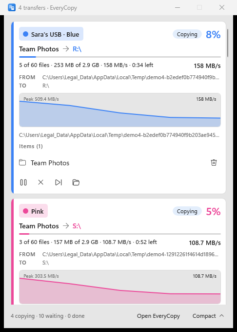

# EveryCopy

A fast, safe file copier and mover for Windows. EveryCopy takes over `Ctrl+V` in Explorer, queues transfers, shows live speed, and can verify every file byte for byte afterwards.

Built with WinUI 3 (Windows App SDK) on .NET 8. It runs in the system tray.



## Features

### Copying and moving
- Copy or move files, folders and whole drives. Drop them on the window, use **Add files** / **Add folder**, or start from Explorer.
- Pick the action for each transfer. A move deletes the originals once they are copied (instant on the same drive).
- Handles locked and hidden files, and refuses a copy that cannot fit before it writes a byte.
- If a drive or network share disappears mid-copy, EveryCopy waits for it to come back and carries on. Big files resume where they stopped.

### Queue
- Transfers run in the order they were added, since two jobs fighting over one disk are slower than either alone.
- Jobs for different drives (for example several USB sticks) run side by side, each with its own colour. Name a drive or change its colour with a click.
- Pause, resume, cancel, skip the current file, retry, and move a job earlier or later.
- Run a job again and what was already copied is skipped.

### Speed
- Live speed graph with a compact and a detailed progress window.
- **Files at once**: small files are copied in parallel (Auto uses this on SSDs and network shares, and keeps spinning disks one file at a time). Big files always go one at a time.
- **Test destination speed** writes a 256 MB temporary file and times it, so you can see whether the drive is the bottleneck.

### Safety
- **Verify every file afterwards** reads the source and the copy together, in big chunks, and compares every byte. A bad copy is deleted and reported. This costs much less than a second full pass.
- Plain-language error messages, with a list of failures you can retry.
- Choose what happens when a file already exists: overwrite, overwrite only if older, skip, or keep both (rename the new one).

### Explorer integration
- Optionally use EveryCopy when you press `Ctrl+V` in Explorer, or ask each time whether to use EveryCopy or Windows copy.
- **Copy with EveryCopy**, **Move with EveryCopy** and **Paste with EveryCopy** in the right-click menu. These live under `HKCU`, so no administrator rights are needed. On Windows 11 they appear under *Show more options*.
- Transfers started from Explorer can show a small progress window instead of opening the full app.

### Everything else
- Start with Windows, hidden in the tray.
- History of finished transfers.
- When all transfers finish: do nothing, sleep, or shut down.
- Light, dark or system theme.

## Requirements

- Windows 10 (build 17763) or later, 64-bit.
- To build: the .NET 8 SDK and, for the installer, [Inno Setup](https://jrsoftware.org/isinfo.php).

## Build and run

```powershell
dotnet build EveryCopy.csproj -c Release
dotnet run --project EveryCopy.csproj
```

## Tests

```powershell
dotnet test tests\EveryCopy.Tests\EveryCopy.Tests.csproj
```

## Build the installer

```powershell
powershell -ExecutionPolicy Bypass -File build-installer.ps1
```

This publishes a self-contained build to `publish\` and compiles `installer\EveryCopy.iss` with Inno Setup. The installer is written to `installer\Output\`.

## Project layout

| Path | What it holds |
|------|---------------|
| `MainWindow.xaml*`, `ProgressWindow.xaml*` | Main window and the transfer progress window |
| `Models/CopyJob.cs` | A transfer and its state |
| `Services/CopyEngine.cs`, `Services/NativeCopy.cs` | The copy engine, resume and verify |
| `Services/CopyQueue.cs` | Ordering and per-drive scheduling |
| `Services/PasteHook.cs`, `Services/ClipboardFiles.cs`, `Services/ContextMenu.cs` | Explorer integration |
| `Services/Benchmark.cs`, `Services/DriveKind.cs`, `Services/Destinations.cs` | Drive detection and speed test |
| `Services/TrayIcon.cs`, `Services/Startup.cs`, `Services/SingleInstance.cs` | Tray, autostart, single instance |
| `Services/HistoryStore.cs`, `Services/JobStore.cs`, `Services/AppSettings.cs` | Saved history, jobs and settings |
| `tests/EveryCopy.Tests` | Engine tests |

## Author

Arman Soltani
